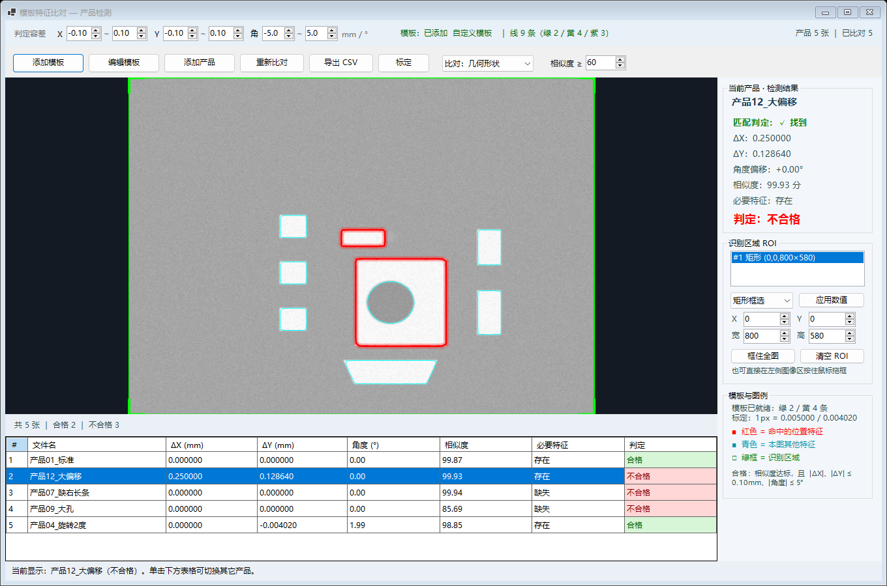
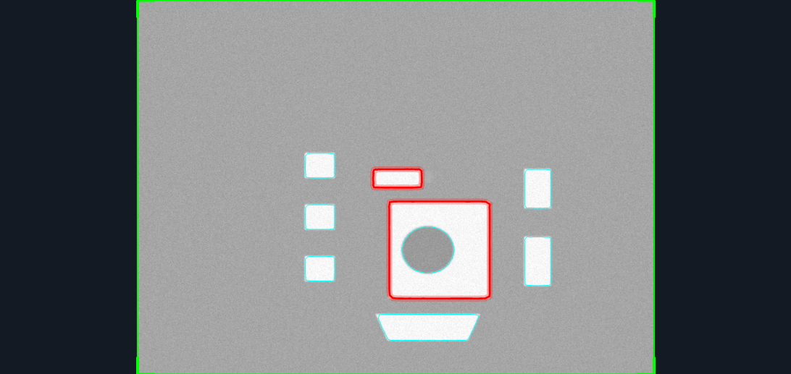

# 模板特征比对 · TemplateMatchDemo

基于**轮廓几何特征**的工件位置偏移与缺陷检测工具。C# WinForms 实现，纯 GDI+，不依赖 OpenCV 等第三方图像库。

核心思路：把样板和产品图各自提取成一圈圈的边界线，然后**按形状找对应**——
形状对不上的说明缺件或变形，形状对得上再算它挪了多远、转了多少度。



> 上图正在检测一个偏移了 50×32 像素的工件：**相似度 99.93，但判定不合格**。
> 因为相似度只衡量"形状像不像"——东西是好的，只是位置超出了 ±0.10mm 的容差。
> 这正是本工具想解决的问题：不让"偏了一点"被误读成"东西不对"。

## 检测细节



- **红色** = 命中的位置特征（参与定位与相似度计算）
- **青色** = 本图识别到的其他边界
- **绿色** = 识别区域（ROI）

轮廓贴合到亚像素级：先用 Otsu 自适应阈值切分，再把边界点沿灰度梯度推到前景/背景的灰度中点。

## 核心特性

**边界提取**
- Otsu 类间方差自适应阈值（不依赖手调单一阈值，背景噪声不会被当成工件）
- 灰度平滑 + 闭运算填补颗粒噪声造成的断裂
- 8 邻域连通标记 + 单链跟踪，带断裂续接，断裂的边界能自动跳接
- 轮廓去毛刺：用「路径长度 / 弦长」识别噪点形成的小环并剪除
- 亚像素精修：按灰度梯度把轮廓推到真实边缘的灰度中点
- 内部暗孔单独提取，按真实轮廓描线，不预设成圆

**形状比对**
- 两种模式：几何形状（形状特征加权）与模板匹配（像素重叠命中率）
- 位移估计：候选配对 → 位移分箱投票 → 质心对齐（对平移天然免疫）
- 角度估计：两两特征质心连线方向差 + 1° 直方图投票
- 必要特征：形状单独匹配 + 一对一分配，每个都必须命中才算"存在"

**判定与交互**
- 输出 ΔX / ΔY / 角度，三者**各自独立**的上下限容差（可不对称）
- 改容差立即重判，不需要重新比对
- 批量导入、表格汇总、CSV 导出
- 标定：像素 ↔ 毫米换算（mm/px 与 DPI 换算）

## 功能对照

| 环节 | 方法 | 实现位置 |
|---|---|---|
| 灰度平滑 | 5×5 均值 | `EdgeMap.Smooth` |
| 分割阈值 | Otsu 类间方差最大法 | `FeatureModel.OtsuThreshold` |
| 掩膜清理 | 3×3 闭运算 ×2 | `EdgeMap.Segment` |
| 连通标记 | 8 邻域 + 面积统计 | `EdgeMap.Label` |
| 边界跟踪 | 单链跟踪 + 断点续接 | `EdgeMap.Trace` |
| 去毛刺 | 路径/弦长比剪环 | `EdgeMap.RemoveSpurs` |
| 轮廓圆滑 | 循环均值 + 等弧长重采样 | `EdgeMap.SmoothLine` |
| 亚像素精修 | 灰度梯度推点 | `EdgeMap.RefineEdge` |
| 形状相似度 | 面积32% + 圆度30% + 宽高比20% + 尺寸18% | `GeometryMatcher.ShapeSimilarity` |
| 位移估计 | 配对 → 分箱投票 → 质心 | `GeometryMatcher.Compare` |
| 角度估计 | 质心连线方向差 + 直方图投票 | `GeometryMatcher.Compare` |
| 必要特征 | 形状匹配 + 一对一分配 | `GeometryMatcher.ComputeAttached` |

## 快速开始

**环境**：Visual Studio 2019+ / MSBuild，.NET Framework 4.0（WinForms）
依赖 `lib/ProductLocator.dll` 已随仓库提供，无需额外配置。

```
克隆 → 打开 模板检测演示.sln → 直接生成运行
```

**使用流程**

1. 【添加模板】→ 导入样板图 → 拖框选识别区域（或点"框住全图"）
2. 点选抓到的边界，设置颜色：
   - **绿色·判断位置**：参与定位和相似度计算，建议选 2 条以上形状不同的
   - **黄色·必须有**：缺了这件就直接判不合格（检缺件靠它）
   - **紫色·忽略**：不关心
3. 【完成】→【添加产品】→ 多选图片 → 自动比对
4. 顶部信息栏按实际精度要求设置 X / Y / 角度容差

## 演示数据

`测试产品图/` 下 15 张 800×580 BMP 全部是**程序化生成的虚构演示件**，
不对应任何真实产品、客户或检测标准，仅用于演示检测流程。

建议的着色方案与逐张预期结果见 [`测试产品图/测试说明.txt`](测试产品图/测试说明.txt)。

## 已知限制

- **角度精度**：形状近似对称的特征在估计角度时有歧义，大角度（>20°）读数可能偏差数度；
  小角度（±2°）精度约 ±0.5°。需要精确测角时，请选方向性强的特征（长条、斜边）做绿色。
- **不做尺度归一**：几何比对能容忍约 10% 以内的缩放，超出范围会明显掉分。
- **依赖分割质量**：如果产品图光照/对比度与样板差异过大，边界抓取会不稳定，
  建议先用标定和灵敏度调参。
- **单框内多工件**：同一 ROI 内若多个工件粘连，会被当成一个轮廓处理。

## 许可证

仅供学习与内部演示使用。
